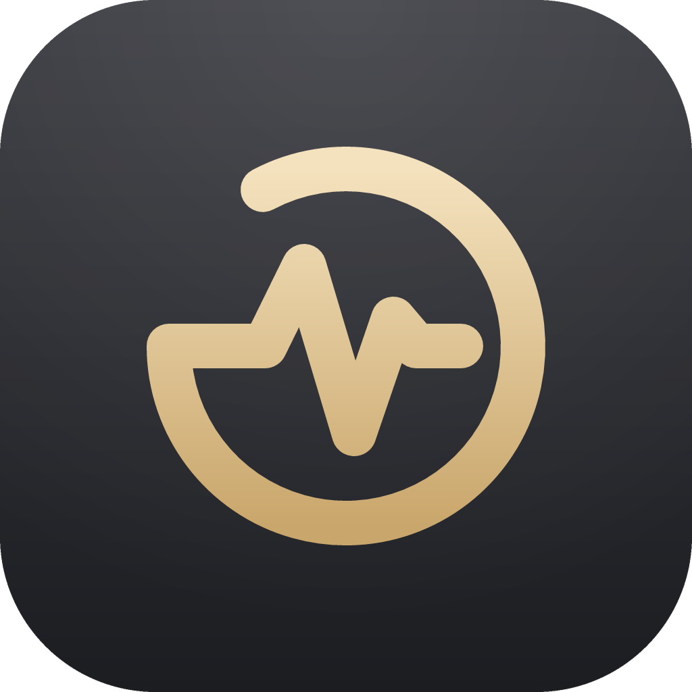
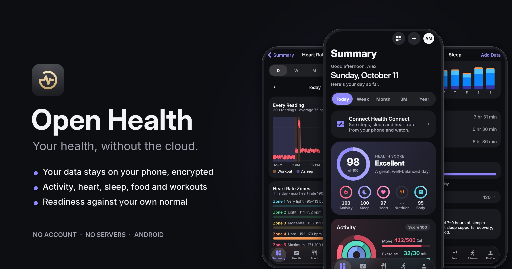
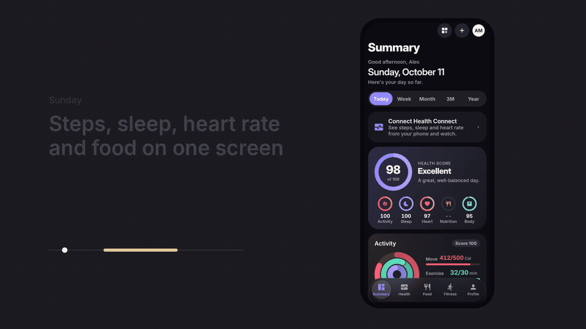
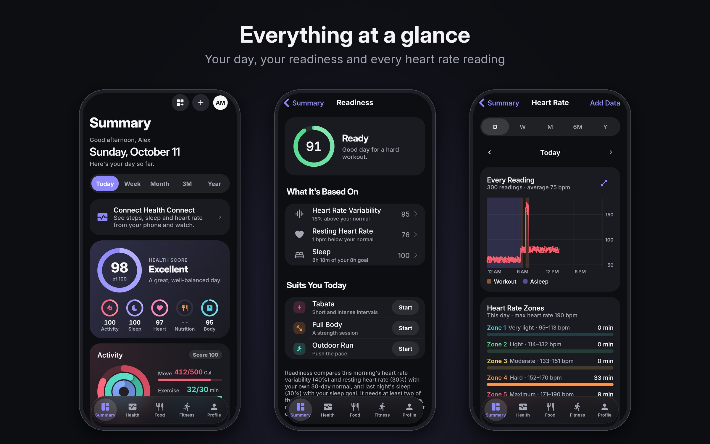
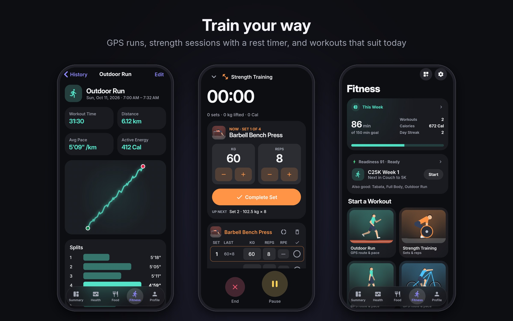
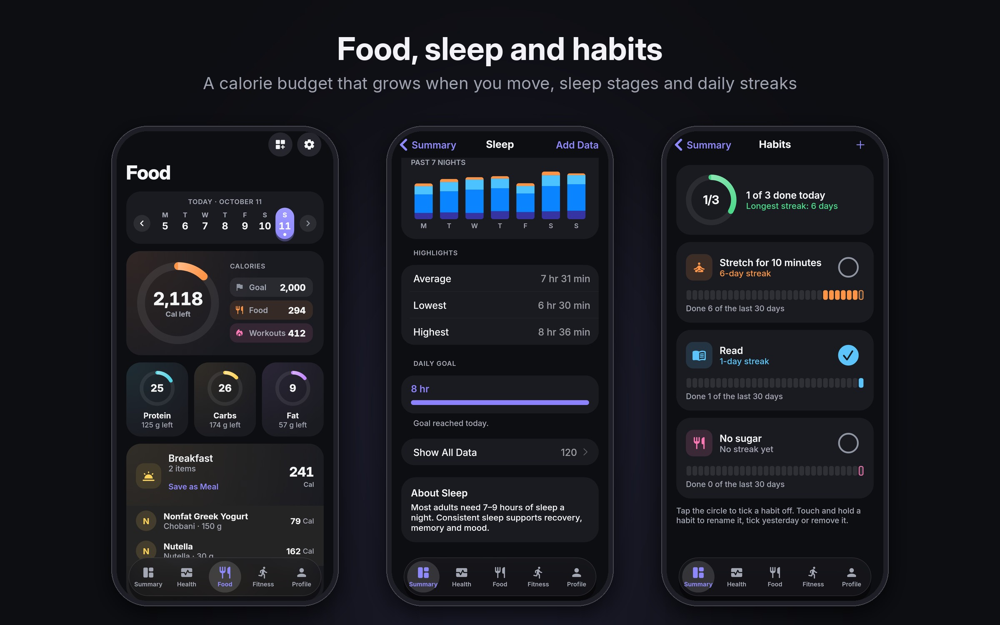
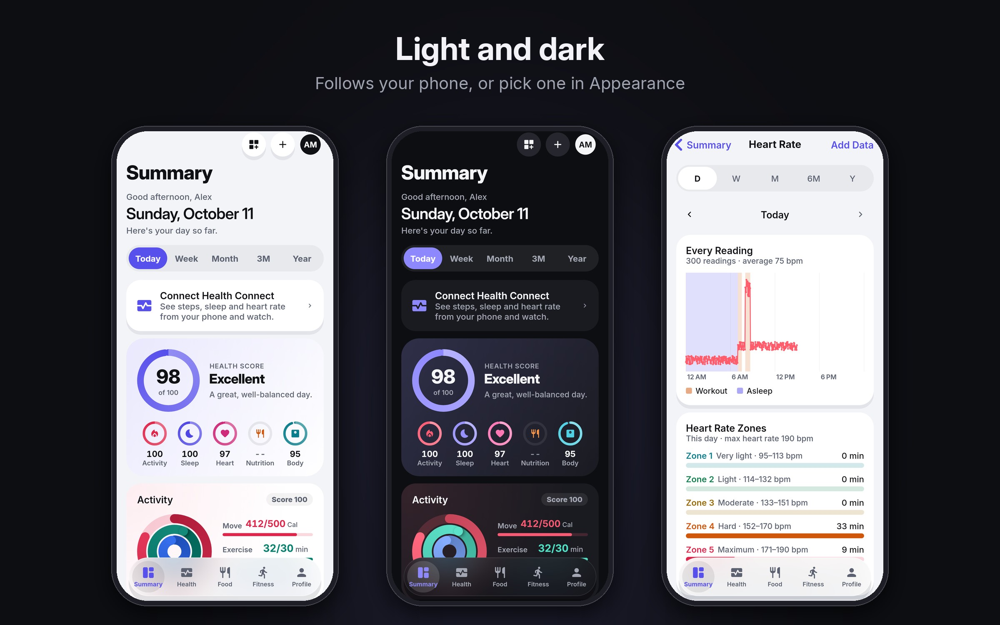

<p align="center">
  
</p>

<h1 align="center">Open Health</h1>

<p align="center">
  A private alternative to Apple Health and Samsung Health, with its source code open to read.
</p>

<p align="center">
  <a href="https://github.com/untrustedtech/open-health/releases/latest"></a>
  <a href="LICENSE"></a>
  
  
  
</p>

<p align="center">
  <a href="https://github.com/untrustedtech/open-health/releases/latest"><strong>Download</strong></a> ·
  <a href="https://untrustedtech.dev"><strong>Website</strong></a> ·
  <a href="docs/PRIVACY_POLICY.md">Privacy</a> ·
  <a href="#in-the-works">Roadmap</a> ·
  <a href="CONTRIBUTING.md">Contribute</a>
</p>

<p align="center"></p>

<p align="center">
  
  <br><sub><a href="https://github.com/UntrustedTech/open-health/raw/main/docs/promo/health-promo.mp4">Download the promo with sound (MP4)</a></sub>
</p>

---

## About

Health keeps track of activity, heart, sleep, food, water, mood,
medications, cycle and workouts in one app, with trends over weeks, months
and years. There are no accounts, ads or trackers, and nothing goes to a
server: your data stays on your phone, encrypted.

Every tab is a board of widgets you can add, remove, resize and reorder.
The app is available in English, Spanish, French, German, Chinese and
Japanese.

## Features

<table>
  <tr>
    <td width="50%" valign="top">

### Summary and trends
- Daily health score with activity, sleep, heart, nutrition and body
- Every heart rate reading of a day, with zones, full screen with pinch to zoom
- Chart styles: curve, line, bars, pills, stems, dots and dashes
- Light, dark and automatic mode, with a choice of theme colour
- Today, week, month, 3-month and year views
- Trends that show what's changing, and monthly recaps
- Readiness score from HRV, resting heart rate and sleep
- Achievements and streaks
- PDF health report to share with your doctor

</td>
    <td width="50%" valign="top">

### Health tracking
- Steps, heart rate, HRV, SpO₂, blood pressure and blood glucose
- Temperature, breathing rate, body fat and body composition
- Sleep with stages and a bedtime schedule
- Weight, and progress photos you can compare side by side
- Medications with reminders
- Cycle tracking with predictions, and period days imported from Health Connect
- Mood, mindfulness and fasting with a live countdown
- Habits with their own icons and colours, streaks and best streaks
- Water with one-tap glass, bottle and big bottle sizes in your units

</td>
  </tr>
  <tr>
    <td width="50%" valign="top">

### Workouts
- GPS runs, walks, rides, paddles and ski runs, with maps and splits
- Speed, top speed and a speed chart for cycling, skating and other speed sports
- Live notifications while you work out, rest or fast (Live Updates on Android 16+)
- Strength training with sets, reps, rest timer and personal records
- Exercise library with illustrations
- Guided flows, Pilates and training programs (like Couch to 5K)
- Heart rate zones
- Aerial, climbing, board, water and snow sports

</td>
    <td width="50%" valign="top">

### Food
- Calorie and macro tracking with daily goals
- Barcode scanner and food search that updates as you type ([Open Food Facts](https://world.openfoodfacts.org))
- Meals logged in other apps, read from Health Connect
- Meals you can save and reuse
- Water tracking

### Your data
- App Lock with fingerprint or face
- Encrypted backups, automatic or manual
- Export to CSV (optionally in an AES-256 encrypted zip) and PDF
- Reads from (and can write workouts to) Health Connect
- Reminders for water, activity, medications, meals, bedtime and habits,
  with a habits notification you can tick off
- Checks for a new version once a day and tells you what's new after
  each update

</td>
  </tr>
</table>

## How it all fits together

Most trackers keep each number in its own box. Health connects them, so
every number is read against the rest of your data and your own normal,
not a population average.

```
 Health Connect / Apple Health ──┐
   (watch, phone, other apps)    │
                                 ▼
 Your logs: food, water, ──► one encrypted store on your phone
 mood, meds, cycle, weight       │
                                 ├─► Readiness ──► today's workout suggestion
 Workouts (GPS, strength) ───────┤
                                 ├─► Calorie budget ──► Food
                                 ├─► Health score (weighted by your goal)
                                 └─► Trends, recaps, achievements, PDF report
```

- **Your normal, not an average.** Readiness compares this morning's HRV
  and resting heart rate with your own last 30 days, and last night's
  sleep with your sleep goal. If a signal is missing it's left out and the
  rest are re-weighted, and with fewer than two you get no score rather
  than a made-up one.
- **Readiness picks the workout.** The Fitness tab suggests a workout that
  suits how recovered you are, leading with the next session of your
  training program unless today calls for rest.
- **Workouts feed your food budget.** Your calorie goal comes from your
  profile and how active you really are (your average steps). Saving a
  workout adds what it burned to the day's budget. If your goal already
  allows for everyday movement, only workouts are added, so nothing is
  counted twice.
- **Heart rate zones that fit you.** Zones follow your maximum heart rate
  from your age and update as you get older, and Heart Rate shows the
  minutes you spent in each.
- **Weight without the noise.** Weigh-ins are smoothed into a trend line,
  so water and salt swings don't hide the real direction, and the body
  score checks your weekly pace against the plan you set.
- **One score, weighted by your goal.** The Summary scores activity,
  sleep, heart, nutrition and body, and weights them by what you're
  working towards: activity and heart count more for fitness, nutrition
  and body more for weight change. Today is judged against how much of
  the day has passed, so 9 a.m. never looks like a failed day.
- **Settings that agree.** Turning on a sleep schedule sets your sleep
  goal to your time in bed, so Readiness, the score and Sleep all use the
  same target.
- **The long view.** Trends compare your last 90 days with the year
  before. Monthly recaps, achievements and a PDF report for your doctor
  are all built from the same data.

## Screenshots

<p align="center"></p>
<p align="center"></p>
<p align="center"></p>
<p align="center"></p>

## Download

| Platform | Where | Status |
|---|---|---|
| **Android** (8.0+) | [GitHub Releases](https://github.com/untrustedtech/open-health/releases/latest) | Available |
| **iOS** | GitHub Releases | Coming soon |
| **Android** | Google Play | Coming soon |
| **iOS** | App Store | Planned |

**Installing from GitHub:** download `Health-<version>.apk` from the latest
release, open it, and allow installing from your browser or file manager
when Android asks. To get updates automatically, add this repository to
[Obtainium](https://github.com/ImranR98/Obtainium).

**Google Play beta:** Health is coming to Google Play soon. Want to test it
there before it launches? Email **support@untrustedtech.dev** to join the beta.

## In the works

These are being worked on and aren't in this version yet. See the
[roadmap](docs/ROADMAP.md) for the order.

- **Plugin support:** small add-ons that bring new features, such as
  reading a watch or sensor directly, each running sandboxed with only
  the permissions you allow.
- **Themes and app icons:** extra styles for the whole app, a theme
  editor and more Home Screen icons.
- **iOS release:** an iPhone build on GitHub Releases.
- **Google Play** (coming soon; email support@untrustedtech.dev to join
  the beta) **and the App Store.**

Ideas and requests are welcome in [Issues](https://github.com/untrustedtech/open-health/issues).

## Privacy

Health has **no servers**. It never sends your data anywhere, and we never
see it. The app only goes online when you ask it to:

- looking up a food on Open Food Facts,
- loading street maps from OpenStreetMap, if you turn them on,
- syncing with Health Connect, if you connect it.

Read the full [Privacy Policy](docs/PRIVACY_POLICY.md).

## Building from source

You'll need [Flutter](https://flutter.dev) (stable channel; see
`pubspec.yaml` for the Dart SDK version) and the Android SDK.

```sh
git clone https://github.com/untrustedtech/open-health.git
cd open-health
flutter pub get
flutter test              # unit and widget tests
flutter run               # on a connected phone
./release.sh              # analyze, test, and build release/Health-<version>-<build>.apk
./ios_release.sh          # build release/Health-<version>-<build>.ipa on GitHub (macOS)
```

Release builds need a signing key in `android/key.properties` (not in the
repository); see [Flutter's signing guide](https://flutter.dev/to/reference-keystore).

## Contributing

Bug reports, translations and pull requests are welcome. Please read
[CONTRIBUTING.md](CONTRIBUTING.md) first: code contributions need the
[Contributor License Agreement](CLA.md). To report a security problem, see
[SECURITY.md](SECURITY.md).

## Documents

- [Privacy Policy](docs/PRIVACY_POLICY.md)
- [Terms of Use (EULA)](docs/EULA.md)
- [Copyright & DMCA Policy](docs/DMCA.md)

> [!IMPORTANT]
> Health is a wellness tracker, **not a medical device**, and doesn't give
> medical advice. Talk to a doctor before changing your exercise, diet,
> fasting or medication. In an emergency, call your local emergency number.

## License

Copyright © 2026 [UntrustedTech](https://untrustedtech.dev).

Health's source code is available under the
[PolyForm Noncommercial License 1.0.0](LICENSE). In short:

- **You can** read the code, build the app (APK or iOS) for yourself, change
  it, and use it for any non-commercial purpose.
- **You can** share copies for free, as long as they keep the license and
  the copyright notice, so it's clear the app comes from UntrustedTech.
- **You can't** sell it, charge for it, put it in a paid or ad-supported
  app, or use it for any commercial purpose.
- **You can't** present it, or a changed version, as your own work.

The [LICENSE](LICENSE) file is the full, binding text; this summary isn't.
It comes as is, without warranty. For commercial licensing, contact
support@untrustedtech.dev.

"UntrustedTech", and the app's published name and icon, identify official
releases. The license doesn't cover them, so copies and changed versions
can't use them in a way that suggests they're ours.

Health includes fonts, data and code by others, each under its own license;
see **Settings → About → Acknowledgements** in the app.

Health is not affiliated with, or endorsed by, Apple or Samsung. Apple Health
is a trademark of Apple Inc.; Samsung Health is a trademark of Samsung
Electronics Co., Ltd.
